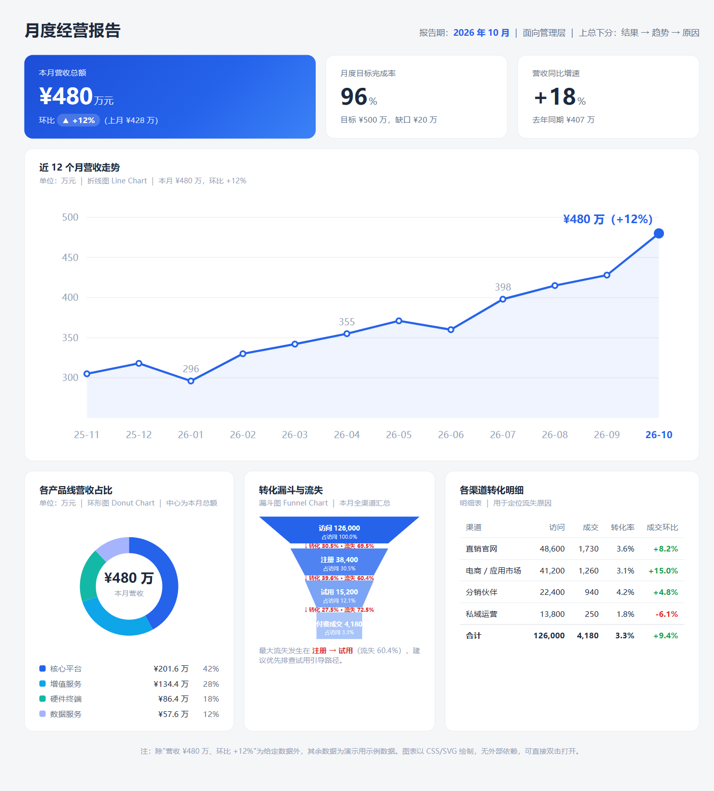
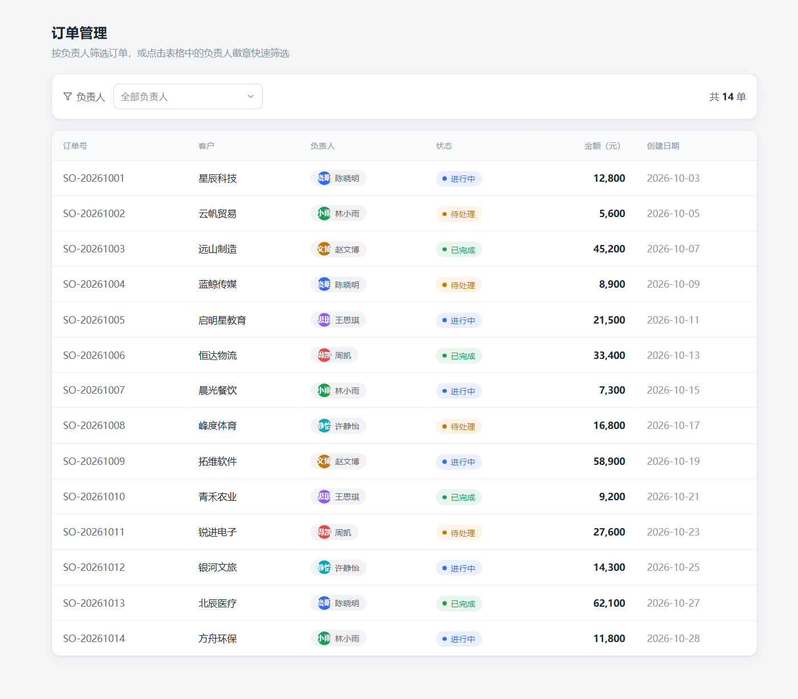
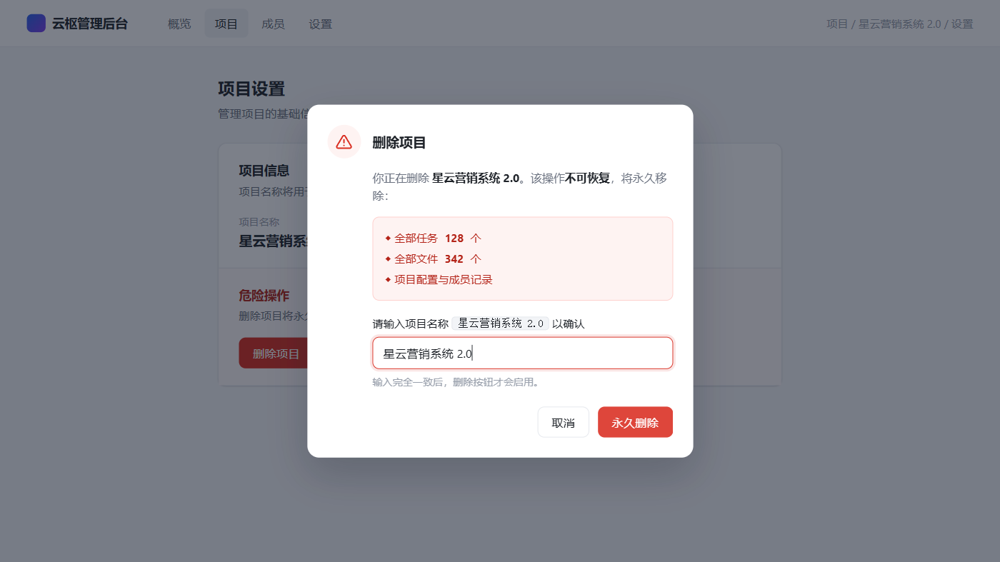
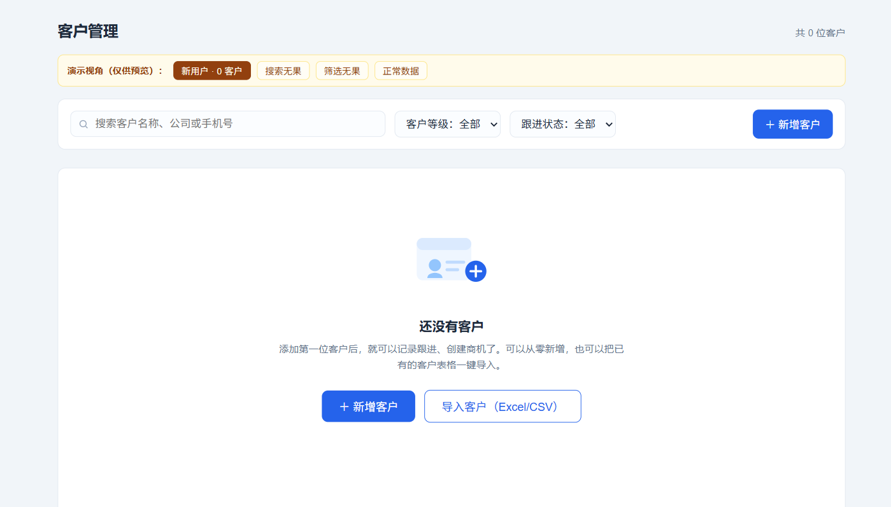

<div align="center">

# Better Web Controls

**Vibe Coding 网页控件翻译词典**

把"做个下拉""加个按钮""做个好看的导航"这类模糊需求，翻译成 AI 能一次做对的准确描述：
控件名称、形式、操作规则，一个不少。

[](LICENSE)
[](https://nodejs.org)
[](#安装)
[](https://github.com/vercel-labs/skills)
[](#评测结果)

</div>

---

## 效果预览

以下页面均由 AI 在本技能工作流下生成（单文件 HTML，来自评测场景，可在 `web-controls-workspace/` 中直接打开）：

| 登录页（Split Screen） | 月度经营报告（上总下分） |
|:---:|:---:|
|  |  |
| **下拉选人 + 表格筛选** | **导航栏（悬浮吸顶）** |
|  |  |
| **轮播** | **删除确认（输入文字确认）** |
|  |  |
| **空状态（首次使用）** | |
|  | |

## 为什么需要它

让 AI 生成页面时，"做个下拉"这类说法会得到赌运气的结果：AI 自己猜形式、猜操作规则，猜错了就返工。

同一个需求，两种说法的差别：

| | 用户对 AI 说 | AI 的产出 |
|---|---|---|
| 翻译前 | "帮我做个下拉，能选负责人" | 随机发挥：可能是原生 `<select>`，可能缺清空、缺键盘操作，无选型依据 |
| 翻译后 | "负责人用 Select 单选下拉：选项为团队成员、单选、选中打勾、可 × 清空重选、点外部或 Esc 关闭" | 按规格一次成型，形式与操作规则全部到位 |

本技能把这个"翻译"过程内置成 AI 的工作流：识别需求类型、查参考文件、列候选并写明选型理由，再输出可执行的规格。

## 安装

```bash
# 交互式：自动检测已安装的 agent（OpenCode / Claude Code / Cursor 等），选择后安装
npx skills add shanchuann/better-web-controls

# 指定只装这一个技能、只装到 OpenCode
npx skills add shanchuann/better-web-controls --skill better-web-controls -a opencode

# 全局安装（跨项目可用）
npx skills add shanchuann/better-web-controls -g
```

需要 Node.js 22.20 以上版本。skills CLI 支持 75 个以上的 agent，安装时自动写入对应 agent 的技能目录（OpenCode 为 `.opencode/skills/`，全局安装为 `~/.config/opencode/skills/`），无需手动放置。

## 工作流

安装后，agent 在收到网页、页面或控件类需求时自动执行：

1. **识别需求类型**，路由到对应参考文件（控件、布局、交互规则、修复、图表）
2. **列出候选并说明选型理由**：同一类控件存在多种形式（下拉 7 种、进度 8 种动画、导航 9 种），输出 2 至 3 个候选及适用场景；信息不足时先向用户确认判断依据
3. **写选型笔记**：候选对比、判断依据、升级条件写入 `notes.md`，交付物可复核、可验收
4. **输出规格**：给出可直接使用的 Prompt（名称、形式、操作规则按固定顺序），或按规格直接生成页面

## 评测结果

9 个真实场景，每个场景 4 条断言，对比带技能与不带技能（禁止读取技能目录）的产出：

| 指标 | 带技能 | 不带技能 | 差值 |
|:---:|:---:|:---:|:---:|
| 断言通过 | **36 / 36（100%）** | 31 / 36（86.1%） | **+13.9pp** |

分场景得分：

| # | 场景 | 带技能 | 不带技能 | 不带技能失败项 |
|:---:|---|:---:|:---:|---|
| 0 | 导航栏 | 4/4 | 3/4 | 无候选对比与选型理由 |
| 1 | 页面修复 | 4/4 | 4/4 | — |
| 2 | 轮播 | 4/4 | 4/4 | — |
| 3 | 下拉选人 | 4/4 | 3/4 | 无候选对比与选型理由 |
| 4 | 删除确认 | 4/4 | 4/4 | — |
| 5 | 保存提示 | 4/4 | 4/4 | — |
| 6 | 经营报告图表 | 4/4 | 3/4 | 无图表选型理由 |
| 7 | 空状态双场景 | 4/4 | 3/4 | 无结果态加了错误的大按钮 |
| 8 | 登录页 | 4/4 | 3/4 | 无候选对比与选型理由 |

两点发现：

- **选型过程是主要差距**：5 个失败项中 4 个是"没有候选对比与选型理由"。裸跑直接给实现，过程不可复核；带技能的产出包含候选对比、判断依据与升级条件，可验收。
- **隐性规则决定结果对错**：空状态场景下，裸跑把"搜索无果"做成了"提示加大按钮"，还放了"新建客户"这个会把用户引向错误动作的按钮；带技能按"搜索改关键词、筛选改条件"的规则避开了。

完整报告（含每条断言的判定证据）见 [web-controls-workspace/iteration-2/benchmark.md](web-controls-workspace/iteration-2/benchmark.md)。

## 内容覆盖

| 参考文件 | 内容 |
|---|---|
| `references/controls.md` | 按钮6形态、下拉7种、轮播7种、Tab6种、侧边栏5种、弹窗、进度8种、上传5种、表格5种、特殊控件8种、表单输入控件 |
| `references/layouts.md` | 网站布局7种、AI产品布局6种、登录页5种、导航9种、首页10模块、首屏设计、大屏5种布局、工作台实战、风格参考图 |
| `references/rules.md` | 提示7级、二次确认7种、等待体验6种、校验时机、表单7检查点、空状态5种、对齐5种、长页面定位7种、分组方式、设计术语7词 |
| `references/fixes.md` | 细节修复7句（症状、病因、指令）、常见问题6句 Prompt |
| `references/charts.md` | 10种图表与场景选型、决策问句 |

## 仓库结构

```
skills/better-web-controls/   技能本体（npx skills add 的安装源）
├── SKILL.md                  触发条件、工作流、核心公式、完整示例
├── CHANGELOG.md              版本记录
└── references/               5 个参考文件（按需加载）
docs/screenshots/             效果图（评测产出的页面截图）
web-controls-workspace/       评测（9 个场景，对比带与不带技能的结果）
```

各 agent 的技能目录（如 `.opencode/skills/`、`.agents/skills/`）是安装时自动生成的本机副本，不入版本控制。

## 更新

技能更新后，用户端执行：

```bash
npx skills update
```

## License

[MIT](LICENSE)
